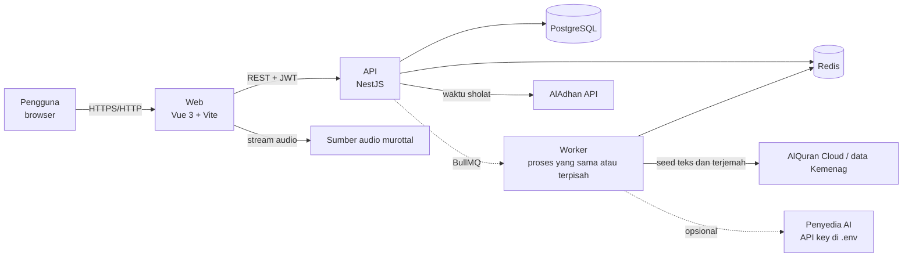
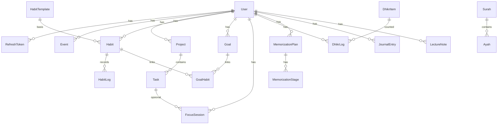
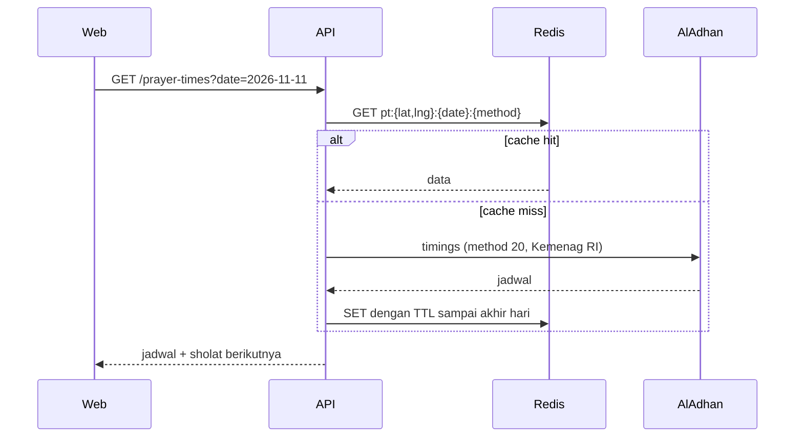
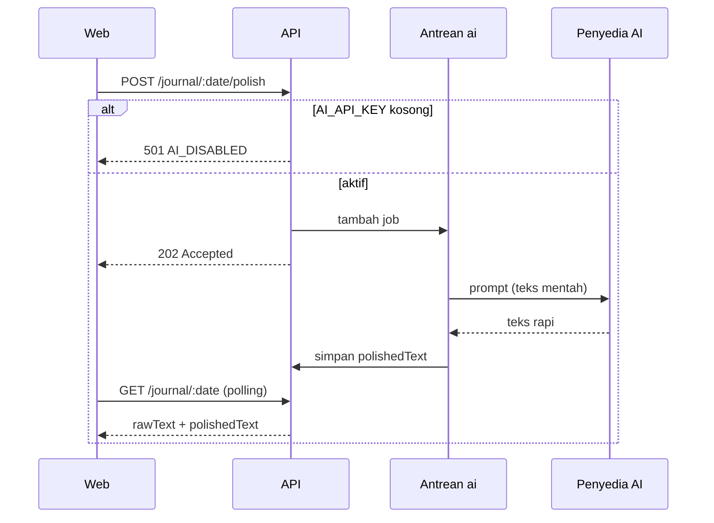

# Arsitektur Muhasabah Daily

Dokumen ini menjelaskan rancangan teknis Muhasabah Daily, aplikasi produktivitas Muslim open source yang dijalankan lokal. Referensi fitur: muslimpositive.id (M+ Life). Nama produk masih usulan.

- Versi dokumen: 0.1 (draft, 11 November 2026)
- Status keputusan: stack final Vue 3 + NestJS, tanpa hosting, tanpa pembayaran, AI opsional
- Status implementasi: fase 0–6 selesai (lihat bagian 16)

## 1. Tujuan dan batasan

**Tujuan**

- Satu aplikasi untuk Schedule, To-Do, Habits, Goals, Fokus, Dzikir, Hafidz, Jurnal, dan Catatan Kajian, disusun di sekitar waktu sholat.
- Mudah dijalankan siapa pun dengan satu perintah (`docker compose up`).
- Kode rapi dan teruji, karena proyek ini dipakai sebagai portofolio.

**Batasan**

- Tidak ada hosting, demo publik, pembayaran, lisensi, atau gerbang akses.
- Konten pihak ketiga (teks Al-Qur'an, terjemah, audio) tidak disimpan di repo. Diunduh oleh seeder dan di-stream dari sumbernya.
- Fitur AI opsional dan mati bila API key kosong.
- Satu bahasa (TypeScript) di seluruh stack.

## 2. Gambaran sistem



| Komponen   | Peran                                                                                                  |
| ---------- | ------------------------------------------------------------------------------------------------------ |
| Web        | SPA Vue 3. Semua tampilan dan logika interaksi (timer fokus, counter dzikir, pemutar Hafidz).          |
| API        | NestJS. Autentikasi, aturan bisnis, akses data, integrasi eksternal.                                   |
| PostgreSQL | Penyimpanan utama data pengguna dan konten hasil seed.                                                 |
| Redis      | Cache (waktu sholat, ayat), antrean BullMQ, rate limit.                                                |
| Worker     | Menjalankan job latar: seeding data, AI Polish, pengingat. Pada v0.1 berjalan di proses API yang sama. |

## 3. Struktur repo (monorepo pnpm)

```
muhasabah-daily/
├─ apps/
│  ├─ api/                 # NestJS
│  │  ├─ src/
│  │  │  ├─ main.ts
│  │  │  ├─ setup-app.ts   # prefix, helmet, cookie, CORS (dipakai main dan test)
│  │  │  ├─ app.module.ts
│  │  │  ├─ common/        # guard, filter, decorator, exception
│  │  │  ├─ config/        # validasi env (zod)
│  │  │  ├─ prisma/        # PrismaModule dan PrismaService
│  │  │  ├─ redis/         # klien ioredis
│  │  │  ├─ queue/         # koneksi BullMQ dan nama antrean
│  │  │  └─ modules/
│  │  │     ├─ auth/
│  │  │     ├─ users/
│  │  │     ├─ prayer-times/
│  │  │     ├─ health/
│  │  │     ├─ schedule/       # fase 2
│  │  │     ├─ tasks/          # fase 2 (projects + tasks)
│  │  │     ├─ habits/         # fase 2
│  │  │     ├─ goals/          # fase 2
│  │  │     ├─ focus/          # fase 3
│  │  │     ├─ dhikr/          # fase 3
│  │  │     ├─ quran/          # fase 5, data ayat, bukan fitur hafalan
│  │  │     ├─ memorization/   # Hafidz (fase 5)
│  │  │     ├─ journal/        # + AI Polish (fase 5)
│  │  │     └─ lecture-notes/  # fase 5
│  │  ├─ prisma/
│  │  │  ├─ schema.prisma
│  │  │  ├─ migrations/
│  │  │  └─ seed/          # habit_templates, dhikr_items, quran
│  │  └─ test/             # integrasi API (Jest + Supertest)
│  └─ web/                 # Vue 3 + Vite
│     ├─ src/
│     │  ├─ app/           # router, layout
│     │  ├─ features/      # satu folder per modul (lihat bagian 5)
│     │  ├─ shared/        # komponen UI, composable, util
│     │  └─ api/           # klien HTTP bertipe
│     └─ e2e/              # Playwright
├─ packages/
│  └─ shared/              # tipe, enum, skema validasi (zod) yang dipakai web dan api
├─ docker/                 # skrip init container
├─ docker-compose.yml
├─ .env.example
├─ DATA_SOURCES.md         # atribusi dan lisensi data pihak ketiga
├─ ARCHITECTURE.md
├─ CONTRIBUTING.md
└─ LICENSE
```

Aturan ketergantungan: `web` dan `api` boleh memakai `packages/shared`. `web` tidak boleh mengimpor dari `api` dan sebaliknya (ditegakkan oleh ESLint `no-restricted-imports`).

## 4. Backend (NestJS)

### 4.1 Prinsip

- Satu modul per fitur. Setiap modul berisi `controller`, `service`, `dto`, dan (bila perlu) `repository` tipis di atas Prisma.
- Controller hanya memvalidasi dan memetakan request. Aturan bisnis ada di service.
- Semua data milik pengguna difilter dengan `userId` dari token. Tidak ada endpoint yang menerima `userId` dari klien.
- Validasi global dengan `ZodValidationPipe` dari `nestjs-zod`. Skema berasal dari `packages/shared` dan memakai `.strict()` (padanan `whitelist` + `forbidNonWhitelisted`).
- Dokumentasi API otomatis dengan Swagger di `/docs` (hanya saat `NODE_ENV != production`).

### 4.2 Modul dan tanggung jawab

| Modul         | Tanggung jawab                                             | Fase |
| ------------- | ---------------------------------------------------------- | ---- |
| auth          | Daftar, masuk, refresh token, keluar                       | 1    |
| users         | Profil, lokasi, zona waktu, tema, hapus akun               | 1    |
| prayer-times  | Ambil dan cache waktu sholat, hitung sholat berikutnya     | 1    |
| health        | Cek koneksi database dan Redis                             | 1    |
| schedule      | Event dan agenda, tampilan hari/minggu/bulan               | 2    |
| tasks         | Proyek dan tugas, prioritas, deadline, fokus hari ini      | 2    |
| habits        | Habit, log harian, insight (streak, konsistensi, proyeksi) | 2    |
| goals         | Target numerik, tautan ke habit, progres                   | 2    |
| focus         | Riwayat sesi fokus                                         | 3    |
| dhikr         | Konten dzikir dan log hitungan harian                      | 3    |
| quran         | Sajikan data surah dan ayat dari database lokal            | 5    |
| memorization  | Rencana hafalan dan tahap tikrar                           | 5    |
| journal       | Jurnal harian dan AI Polish                                | 5    |
| lecture-notes | Catatan kajian dengan rujukan ayat                         | 5    |

### 4.3 Autentikasi dan sesi

- Kata sandi di-hash dengan Argon2id (m=19 MiB, t=2, p=1). Login dengan email tak dikenal tetap menjalankan verifikasi hash tiruan agar waktu respons seragam.
- Access token JWT HS256 berumur pendek (15 menit), dikirim lewat header `Authorization: Bearer`. Web menyimpannya hanya di memori.
- Refresh token acak 32 byte, disimpan sebagai HMAC-SHA256 di tabel `refresh_tokens`, dikirim lewat cookie `rt` (`httpOnly`, `SameSite=Lax`, `Path=/api/v1/auth`, `Secure` di production). Dirotasi setiap dipakai. Jika token lama dipakai ulang (atau dua permintaan berebut token yang sama), seluruh keluarga token (`familyId`) dicabut.
- `JwtAuthGuard` dipasang global. Endpoint terbuka ditandai dekorator `@Public()`.
- Rate limit dengan `@nestjs/throttler`: global 120/menit, `/auth/*` 10/menit, `/auth/refresh` 30/menit (atur lewat `AUTH_RATE_LIMIT`; server E2E menaikkannya karena banyak akun dibuat dari IP yang sama).
- Login Google (OAuth) menyusul setelah v1.0.

### 4.4 Format respons dan error

- Sukses: JSON langsung berisi data. Daftar memakai `{ items, nextCursor }`.
- Error: `{ statusCode, code, message, details? }` lewat `AllExceptionsFilter`. `code` berupa string stabil (mis. `HABIT_NOT_FOUND`) yang didefinisikan di `packages/shared/src/errors.ts`.
- Tanggal disimpan UTC (`timestamptz`). Tanggal harian (log habit, jurnal) disimpan sebagai `date` dalam zona waktu pengguna, lihat 6.2.

### 4.5 Pekerjaan latar (BullMQ)

| Antrean     | Pekerjaan                      | Pemicu                                       |
| ----------- | ------------------------------ | -------------------------------------------- |
| `seed`      | Unduh dan impor data Al-Qur'an | Perintah `pnpm seed:quran`                   |
| `ai`        | AI Polish jurnal               | Permintaan pengguna                          |
| `reminders` | Pengingat sholat dan agenda    | Jadwal `@nestjs/schedule` (fase 6, opsional) |

Koneksi BullMQ (`src/queue/queue.module.ts`) sudah disiapkan; processor tiap antrean didaftarkan oleh modul fiturnya.

## 5. Frontend (Vue 3)

### 5.1 Teknologi

Vue 3 (Composition API, `<script setup>`), Vite, TypeScript, Pinia, Vue Router, Tailwind CSS 4, TipTap untuk editor Catatan Kajian (fase 5). Tanpa SSR.

### 5.2 Struktur fitur

```
src/features/habits/
├─ components/      # HabitGrid.vue, HabitInsightCard.vue
├─ composables/     # useHabits.ts, useHabitInsights.ts
├─ stores/          # habits.store.ts
├─ api.ts           # panggilan HTTP khusus fitur
├─ routes.ts
└─ index.ts         # satu-satunya pintu masuk yang diekspor
```

Fitur lain tidak boleh mengimpor isi folder fitur lain, hanya lewat `index.ts` (ditegakkan oleh ESLint).

### 5.3 Pola penting

- **Klien API bertipe:** tipe request dan respons dari `packages/shared`. Klien menangani refresh token otomatis dan mengulang request yang gagal 401 satu kali; permintaan paralel berbagi satu refresh.
- **State:** Pinia untuk state lintas halaman (sesi, tema, waktu sholat). Data server dimuat per halaman lewat composable.
- **Timer fokus:** hitung sisa waktu dari selisih `Date.now()` terhadap waktu mulai, bukan dari hitungan interval, supaya akurat saat tab di latar belakang. Pola yang sama sudah dipakai `useCountdown` untuk hitung mundur sholat.
- **Counter dzikir:** hitungan di klien, disinkronkan ke API dengan debounce (mis. 1 detik setelah ketukan terakhir).
- **Pemutar Hafidz:** state machine sederhana (`idle → playing(ayat, ulangan) → next → done`) di atas elemen `<audio>`. Urutan dan jumlah ulangan berasal dari `memorization_stages`.
- **Tema:** kelas `dark` pada `<html>`, preferensi disimpan di profil pengguna (dengan salinan di `localStorage` agar halaman masuk tidak berkedip).
- **Aksesibilitas:** semua kontrol dapat diakses keyboard, tautan "lewati ke konten", label form dan `aria-invalid`, kontras warna diperiksa untuk mode terang dan gelap.

## 6. Model data

### 6.1 Diagram relasi



### 6.2 Aturan data

- Semua tabel milik pengguna punya `userId` dan indeks pada `(userId, ...)` untuk kueri utama.
- `HabitLog`: unik pada `(habitId, date)`. `date` adalah tanggal lokal pengguna (tipe `date`), dihitung dari zona waktu di profil (`toLocalDate` di `packages/shared`).
- `JournalEntry`: unik pada `(userId, date)`. Menyimpan `rawText` dan `polishedText` (nullable).
- `Task.focusToday` boolean, di-reset lewat job harian atau dihitung dari `focusDate`.
- `Surah` dan `Ayah` diisi oleh seeder, bersifat baca-saja. Kolom: `arabic`, `latin`, `translationId`, `audioUrl`. File audio tidak disimpan.
- Hapus akun menghapus seluruh data pengguna (cascade).

### 6.3 Cuplikan skema Prisma

```prisma
model Habit {
  id         String     @id @default(cuid())
  userId     String
  templateId String?
  name       String
  position   Int        @default(0)
  active     Boolean    @default(true)
  createdAt  DateTime   @default(now())
  user       User       @relation(fields: [userId], references: [id], onDelete: Cascade)
  logs       HabitLog[]
  goals      GoalHabit[]

  @@index([userId, active, position])
}

model HabitLog {
  id      String   @id @default(cuid())
  habitId String
  date    DateTime @db.Date
  done    Boolean  @default(true)
  habit   Habit    @relation(fields: [habitId], references: [id], onDelete: Cascade)

  @@unique([habitId, date])
}
```

## 7. Desain API

Awalan `/api/v1`. Semua endpoint di bawah butuh token kecuali `/auth/*` dan `/health`.

| Area         | Endpoint                                                                                                         | Keterangan                                                                                            |
| ------------ | ---------------------------------------------------------------------------------------------------------------- | ----------------------------------------------------------------------------------------------------- |
| Auth         | `POST /auth/register`, `/auth/login`, `/auth/refresh`, `/auth/logout`                                            |                                                                                                       |
| Profil       | `GET/PATCH/DELETE /me`                                                                                           | Lokasi, zona waktu, tema; `DELETE` menghapus akun                                                     |
| Waktu sholat | `GET /prayer-times?date=`                                                                                        | Pakai lokasi profil, hasil di-cache                                                                   |
| Waktu sholat | `GET /prayer-times/next`                                                                                         | Sholat berikutnya dan hitung mundur                                                                   |
| Schedule     | `GET /events?from=&to=`, `POST/PATCH/DELETE /events/:id`                                                         |                                                                                                       |
| Tugas        | `GET/POST /projects`, `PATCH/DELETE /projects/:id`, `GET/POST /tasks`, `GET/PATCH/DELETE /tasks/:id`             | Filter `projectId` (`none` = Inbox), `focusToday`, `due`, `status`; paginasi `cursor`                 |
| Habit        | `GET/POST /habits`, `PATCH/DELETE /habits/:id`, `PUT /habits/:id/logs/:date`                                     | `GET` menyertakan log dalam `from..to` (default 7 hari); `PUT` idempoten                              |
| Habit        | `GET /habits/insights?from=&to=`                                                                                 | Streak, konsistensi, proyeksi                                                                         |
| Habit        | `GET /habit-templates`                                                                                           | Library 46 habit, dengan rujukan untuk habit ibadah                                                   |
| Goals        | `GET/POST /goals`, `PATCH/DELETE /goals/:id`, `PUT /goals/:id/habits`                                            |                                                                                                       |
| Fokus        | `POST /focus-sessions`, `GET /focus-sessions?from=&to=`, `DELETE /focus-sessions/:id`                            | `GET` menyertakan `summary` (total, sesi tuntas, detik per tanggal)                                   |
| Dzikir       | `GET /dhikr?group=pagi\|petang\|tidur&date=`, `GET /dhikr/summary?date=`                                         | Konten + hitungan pengguna pada tanggal itu                                                           |
| Dzikir       | `PUT /dhikr/:id/logs/:date`                                                                                      | Menetapkan (bukan menambah) hitungan harian; idempoten                                                |
| Al-Qur'an    | `GET /quran/status`, `GET /quran/surahs`, `GET /quran/surahs/:id`, `GET /quran/surahs/:id/ayahs?from=&to=`       | 503 `QURAN_NOT_SEEDED` bila data belum diimpor                                                        |
| Hafidz       | `GET/POST /memorization-plans`, `GET/PATCH/DELETE /memorization-plans/:id`, `PUT /memorization-plans/:id/stages` | `PATCH` menyimpan progres (`currentStage`); `PUT stages` mengganti tahapan dan menyetel ulang progres |
| Jurnal       | `GET /journal?from=&to=`, `GET/PUT /journal/:date`, `POST/DELETE /journal/:date/polish`, `GET /ai/status`        | `POST polish` mengembalikan 202, hasil lewat polling; `DELETE polish` membuang versi rapi             |
| Kajian       | `GET/POST /lecture-notes`, `GET/PATCH/DELETE /lecture-notes/:id`                                                 | Pencarian `q`, paginasi kursor; isi berupa dokumen TipTap (JSON)                                      |
| Sistem       | `GET /health`                                                                                                    | Cek API, database, Redis                                                                              |

Konvensi: `PATCH` untuk perubahan sebagian, `PUT` pada sumber daya yang kuncinya sudah diketahui (tanggal), kursor untuk paginasi daftar panjang.

## 8. Alur utama

### 8.1 Waktu sholat



- Kunci cache memakai koordinat yang dibulatkan 2 desimal (`pt:-6.21,106.85:2026-11-11:20`) agar pengguna di kota yang sama berbagi cache. TTL sampai tengah malam lokal pengguna (minimal 1 jam).
- Setiap hasil juga disimpan sebagai `pt:last:{lat,lng}:20` (30 hari). Jika AlAdhan gagal, jadwal terakhir itu digeser ke tanggal yang diminta dan dikembalikan dengan `stale: true`. Tanpa cache sama sekali, API membalas 503 `PRAYER_TIMES_UNAVAILABLE`. Antarmuka tetap bisa dipakai tanpa blok sholat.
- Redis hanya cache: bila Redis gagal, API tetap mengambil langsung dari AlAdhan.
- Hitung "sholat berikutnya" dan hitung mundur di klien dari jadwal yang sudah ada (`getNextPrayer` di `packages/shared`). Setelah Isya, klien memuat jadwal esok hari untuk Subuh.

### 8.2 Insight habit

Dihitung di server dari `HabitLog` pada rentang tanggal:

- **Hari aktif:** dari `max(from, startDate habit)` sampai `min(to, hari ini)`. Hari mendatang dan hari sebelum habit dimulai tidak dihitung.
- **Check-in:** jumlah log selesai dalam hari aktif.
- **Streak terbaik:** deret hari berurutan terpanjang di dalam rentang.
- **Streak berjalan:** deret yang berakhir hari ini, atau kemarin bila hari ini belum dicentang (tidak dibatasi rentang).
- **Konsistensi:** check-in dibagi hari aktif, dalam persen.
- **Proyeksi minggu depan:** laju harian dalam 4 minggu terakhir × 7, dibulatkan. Untuk habit yang lebih muda dari 4 minggu, laju dihitung dari hari aktifnya saja agar tidak terlalu rendah.
- **Ringkasan:** jumlah check-in dan proyeksi, maksimum streak, konsistensi gabungan (Σ check-in / Σ hari aktif).

Fungsi perhitungan murni ada di `apps/api/src/modules/habits/habit-insights.ts` dan dites dengan data tetap.

Aturan log: `PUT /habits/:id/logs/:date` dengan `{ done }` bersifat idempoten (`done: false` menghapus log). Tanggal setelah hari ini ditolak (`HABIT_LOG_FUTURE_DATE`), begitu juga tanggal sebelum `startDate` (`HABIT_LOG_BEFORE_START`); pengguna bisa memundurkan `startDate` untuk mengisi hari-hari sebelumnya.

### 8.3 Progres Goal

`progres = nilaiManual + Σ (log habit tertaut × bobot)`. Hasil dibatasi pada `target`. Nilai manual dan kontribusi habit ditampilkan terpisah agar pengguna paham asalnya.

Log habit dihitung sejak `startDate` goal (default tanggal goal dibuat), sehingga riwayat lama tidak langsung memenuhi goal baru. Fungsi `computeGoalProgress` ada di `packages/shared` agar web dan API memakai rumus yang sama. Habit yang ditautkan harus milik pengguna yang sama; menghapus habit melepas tautannya.

### 8.3a Tugas dan jadwal

- **Fokus hari ini** disimpan sebagai `Task.focusDate` (tanggal lokal). `focusToday` dihitung `focusDate == hari ini`, sehingga fokus kedaluwarsa sendiri saat hari berganti tanpa job harian.
- Urutan tugas terbuka: tenggat (kosong di akhir), prioritas (tinggi dulu), waktu dibuat. Paginasi kursor memakai `id`; kursor milik pengguna lain ditolak (`INVALID_CURSOR`).
- Menghapus proyek memindahkan tugasnya ke Inbox (`projectId = null`), tidak ikut menghapus.
- Event menyimpan instan UTC. Event sepanjang hari disimpan dari tengah malam lokal sampai tengah malam berikutnya (akhir eksklusif). `GET /events?from=&to=` mengembalikan event yang beririsan dengan rentang (maks. 100 hari).
- Tampilan hari pada web menyisipkan waktu sholat di antara agenda.

### 8.3b Fokus

- Logika timer murni di `apps/web/src/features/focus/timer.ts`: sisa waktu = `endsAt - Date.now()`, jeda menyimpan sisa dan tidak dihitung sebagai waktu fokus. State disimpan di `localStorage` sehingga timer bertahan saat halaman dimuat ulang dan selesai otomatis bila waktunya lewat saat tab tertutup.
- Sesi fokus dicatat saat selesai (`completed`) atau dihentikan (`cancelled`); sesi di bawah 1 menit tidak dicatat. Server menolak `focusedSeconds` yang melebihi `endedAt - startedAt` (toleransi 5 detik).
- `FocusSession.date` adalah tanggal lokal saat sesi dimulai, untuk ringkasan harian. Menghapus tugas tidak menghapus riwayat sesi (`taskId` menjadi null).
- Bila waktu sholat masuk sebelum sesi berakhir, halaman Fokus menampilkan pengingat.

### 8.3c Dzikir

- Konten (`dhikr_items`) diisi seeder dari `apps/api/prisma/seed/dhikr-content.ts`. Satu baris per grup (`pagi-ayat-kursi`, `petang-ayat-kursi`, …) sehingga hitungan pagi dan petang terpisah.
- Untuk dzikir berupa ayat, seeder mengambil teks rasm Utsmani dan terjemah Kemenag dari AlQuran Cloud, lalu membandingkan dengan teks bawaan (normalisasi tanpa harakat). Tanpa internet (`seed --offline`) teks bawaan dipakai.
- Hitungan dikirim sebagai nilai akhir (`PUT … { count }`), bukan selisih, 1 detik setelah ketukan terakhir. Nilai yang belum terkirim disimpan di `localStorage` per pengguna dan dikirim ulang saat `online`, setiap 20 detik, dan saat tab disembunyikan. Error 4xx dibuang agar antrean tidak macet; error jaringan/5xx diulang. Logika antrean murni ada di `apps/web/src/features/dhikr/sync-queue.ts`.

### 8.4 Seeding data Al-Qur'an

1. `pnpm --filter api seed:quran` menambahkan job `quran` ke antrean `seed`; worker di proses API (`SeedProcessor`) mengerjakannya dan CLI menampilkan progresnya. `--direct` menjalankan impor tanpa API; `--fixture` mengisi data uji kecil (Al-Ikhlas, Al-Falaq, An-Nas) tanpa internet untuk test dan E2E.
2. Job mengunduh tiga edisi lengkap dari AlQuran Cloud: `quran-uthmani` (teks Arab), `id.indonesian` (terjemah Kemenag), `en.transliteration` (transliterasi ejaan Inggris), lalu memeriksa ketiganya berisi 114 surah dan 6.236 ayat dengan nomor yang sejajar.
3. Teks Arab dibersihkan dari BOM dan basmalah yang ditempelkan edisi Utsmani pada ayat pertama (kecuali Al-Fatihah), lalu di-upsert ke `Surah` dan `Ayah` secara idempoten.
4. `audioUrl` diisi dengan URL murottal di `QURAN_AUDIO_BASE_URL` (default Mishary Alafasy di `cdn.islamic.network`), tanpa mengunduh audio. Pemutar Hafidz menangani audio yang gagal dimuat (coba lagi atau lewati ayat).
5. Data tidak disimpan sebagai file dan tidak masuk Git; hanya ada di basis data lokal.

### 8.4a Hafidz

- Rencana menyimpan surah, rentang ayat (maks. 30), dan jumlah ulangan. Tahapan bawaan dibuat oleh `buildTikrarStages` (`packages/shared`): untuk setiap ayat **dengarkan** lalu **baca sendiri**, kemudian **sambung** dengan ayat-ayat sebelumnya.
- Pemutar di web adalah state machine murni (`apps/web/src/features/memorization/player.ts`): `idle → playing(ayat, ulangan) → … → done`, dengan keadaan `paused` dan `error`. Elemen `<audio>` hanya mengikuti state.
- Progres disimpan sebagai `currentStage`; mengganti tahapan lewat `PUT stages` menyetel ulang progres.

### 8.5 AI Polish (opsional)



- Penyedia AI di balik antarmuka `AiProvider` (`apps/api/src/modules/ai`). Implementasi bawaan: Anthropic (Claude), model `AI_MODEL` (default `claude-opus-5-5`), dengan fallback sisi server saat model menolak (`fallbacks: "default"`). Respons `refusal`, `max_tokens`, dan teks kosong dicatat sebagai gagal dengan kode (`AI_REFUSED`, `AI_TRUNCATED`, `AI_EMPTY`); galat jaringan/429/5xx diulang antrean (3 percobaan), kunci API salah tidak diulang.
- Prompt menginstruksikan: rapikan ejaan dan struktur, pertahankan gaya bahasa dan makna, jangan menambah isi; teks jurnal dibungkus tag `<jurnal>` dan diperlakukan sebagai data, bukan instruksi.
- `polishedRawHash` mencatat teks asli yang dirapikan; bila teks asli diubah, respons menandai `polishStale`.
- Kuota harian per pengguna dihitung di Redis (`ai:quota:{user}:{tanggal}`); permintaan ulang saat status `pending` tidak menambah kuota.
- Teks mentah pengguna tidak pernah ditimpa. `polishedText` disimpan terpisah dan pengguna memilih memakai atau tidak.
- Batas: panjang input maksimum dan jumlah panggilan per pengguna per hari (nilai di env).
- Teks jurnal dikirim ke penyedia AI hanya bila pengguna menekan tombol Poles. Beri catatan privasi di antarmuka.

## 9. Konfigurasi

Semua konfigurasi lewat variabel lingkungan, divalidasi dengan zod saat aplikasi mulai (`apps/api/src/config/env.ts`). Aplikasi menolak berjalan bila ada variabel wajib yang hilang.

| Variabel                 | Wajib | Contoh / keterangan                                   |
| ------------------------ | ----- | ----------------------------------------------------- |
| `DATABASE_URL`           | ya    | `postgresql://user:pass@db:5432/muhasabah`            |
| `REDIS_URL`              | ya    | `redis://redis:6379`                                  |
| `JWT_ACCESS_SECRET`      | ya    | String acak, minimal 32 karakter                      |
| `JWT_REFRESH_SECRET`     | ya    | String acak, minimal 32 karakter, berbeda dari access |
| `ALADHAN_BASE_URL`       | tidak | Default `https://api.aladhan.com/v1`                  |
| `ALADHAN_TIMEOUT_MS`     | tidak | Default 5000                                          |
| `JWT_ACCESS_TTL_SECONDS` | tidak | Default 900                                           |
| `REFRESH_TOKEN_TTL_DAYS` | tidak | Default 30                                            |
| `AI_PROVIDER`            | tidak | Kosong berarti AI mati                                |
| `AI_API_KEY`             | tidak | Kunci milik pengguna sendiri                          |
| `AI_DAILY_LIMIT`         | tidak | Default 10 panggilan per pengguna per hari            |
| `AI_MODEL`               | tidak | Default `claude-opus-5-5`                             |
| `AI_MAX_INPUT_CHARS`     | tidak | Default 8000 karakter per permintaan AI Polish        |
| `ALQURAN_CLOUD_BASE_URL` | tidak | Default `https://api.alquran.cloud/v1`                |
| `QURAN_AUDIO_BASE_URL`   | tidak | Default murottal Alafasy di `cdn.islamic.network`     |
| `CORS_ORIGIN`            | tidak | Default `http://localhost:5173` (pisahkan koma)       |
| `AUTH_RATE_LIMIT`        | tidak | Default 10 permintaan `/auth` per menit per IP        |
| `LOG_LEVEL`              | tidak | Default `info`                                        |

`.env.example` berisi semua nama variabel tanpa nilai rahasia. `.env` tidak boleh masuk Git.

## 10. Menjalankan lokal

`docker compose up -d` menjalankan semuanya; panduan lengkap ada di [`docs/self-hosting.md`](docs/self-hosting.md).

| Layanan | Image / sumber                                                                   | Port host                           |
| ------- | -------------------------------------------------------------------------------- | ----------------------------------- |
| `web`   | build `apps/web`: hasil `vite build` disajikan nginx; `/api` diteruskan ke `api` | `${WEB_PORT:-8080}`                 |
| `api`   | build `apps/api` (produksi)                                                      | tidak dibuka; diakses lewat `web`   |
| `db`    | `postgres:17-alpine`                                                             | `127.0.0.1:5432` (untuk `pnpm dev`) |
| `redis` | `redis:7-alpine`                                                                 | `127.0.0.1:6379`                    |

Saat container `api` start (`apps/api/docker/entrypoint.sh`):

1. Secret JWT yang kosong dibuat sekali dan disimpan di volume `api-secrets`.
2. `prisma migrate deploy`.
3. Seed dasar (template habit, dzikir); tanpa internet memakai teks bawaan.
4. Impor Al-Qur'an bila belum lengkap (`--direct --if-empty`); kegagalan tidak menghentikan API. Matikan dengan `SEED_QURAN=false`.

Seeder dikompilasi ke `dist-seed` (`tsconfig.seed.json`), sehingga image produksi tidak memerlukan ts-node.

Cookie refresh memakai `COOKIE_SECURE=auto`: bertanda `Secure` hanya bila permintaan HTTPS (termasuk lewat proxy dengan `X-Forwarded-Proto`, `TRUST_PROXY` mempercayai jaringan lokal/Docker). Dengan begitu login berfungsi lewat `http://IP-lokal` dan tetap aman di balik HTTPS.

Pengembangan:

```bash
cp .env.example .env              # isi JWT_ACCESS_SECRET dan JWT_REFRESH_SECRET
docker compose up -d db redis
pnpm install
pnpm --filter api db:deploy
pnpm --filter api seed
pnpm --filter api seed:quran      # butuh API berjalan, atau tambah -- --direct
pnpm dev                          # web :5173, API :3000
```

### 10.1 PWA

Web memakai `vite-plugin-pwa`: manifest, ikon (dibuat dari `favicon.svg` oleh `pnpm --filter web icons`), dan service worker yang mem-precache kerangka aplikasi. Respons `/api` tidak di-cache karena berisi data pribadi dan harus selalu terbaru. Hitungan dzikir yang dibuat saat offline tetap diantre (8.3c). Service worker hanya aktif di build produksi.

## 11. Pengujian

| Lapisan       | Alat                           | Cakupan                                                                                                                                 |
| ------------- | ------------------------------ | --------------------------------------------------------------------------------------------------------------------------------------- |
| Unit shared   | Vitest                         | Skema zod, `getNextPrayer`, tanggal lokal                                                                                               |
| Unit API      | Jest                           | Fungsi murni: TTL cache, pemetaan AlAdhan, env, filter error                                                                            |
| Integrasi API | Jest + Supertest, database uji | Endpoint per modul, aturan kepemilikan data, rotasi token                                                                               |
| Unit web      | Vitest + Vue Test Utils        | Klien API (refresh), hitung mundur; nanti timer, counter                                                                                |
| E2E           | Playwright + axe-core          | Alur utama tiap modul, dzikir offline, timer (jam tiruan), audit WCAG 2.1 AA semua halaman dan dialog (terang/gelap), tata letak 390 px |

Aturan: test wajib untuk fungsi insight, kepemilikan data (pengguna A tidak bisa membaca data B), dan rotasi refresh token.

Server E2E menjalankan `seed --offline` dan `seed:demo` sehingga test tidak bergantung internet. Audit aksesibilitas dan tata letak berpindah halaman di dalam SPA, bukan memuat ulang, karena `/auth/refresh` dibatasi 30 kali per menit.

Test integrasi memakai basis data `muhasabah_test` (dibuat otomatis oleh `docker/postgres-init.sql`) dan Redis DB 1. E2E memakai Redis DB 2 dan server AlAdhan tiruan (`apps/web/e2e/mock-aladhan.mjs`).

## 12. CI (GitHub Actions)

Pada setiap pull request (`.github/workflows/ci.yml`):

1. Pasang dependensi dengan cache pnpm.
2. Lint (ESLint) dan format (Prettier), cek tipe (`tsc --noEmit`, `vue-tsc`).
3. Unit dan integrasi test (layanan PostgreSQL dan Redis lewat `services:`).
4. Build `web` dan `api`.
5. Pindai rahasia (gitleaks) dan audit dependensi.

Job `docker` membangun image API dan web (tanpa push) untuk memastikan `docker compose up` tetap berjalan. E2E Playwright dijalankan pada push ke cabang utama dan tag rilis. Tidak ada langkah deploy.

## 13. Keamanan dan privasi

- Kata sandi Argon2id, token berumur pendek, refresh token dirotasi dan di-hash di database.
- Otorisasi per baris: semua kueri disaring `userId` dari token. Test khusus memverifikasinya.
- Validasi input di setiap endpoint, batas ukuran body 300 kB, `helmet`, CORS dibatasi ke origin yang dikonfigurasi.
- Rate limit pada endpoint autentikasi dan AI.
- Jurnal berisi data pribadi. Jangan catat isi jurnal di log. Log hanya berisi id dan status; header `authorization` dan `cookie` disamarkan.
- Rahasia hanya di `.env`. CI memindai kebocoran rahasia.
- Hapus akun menghapus seluruh data pengguna.
- Konten keagamaan: rujukan hadis dan sumber ayat selalu ditampilkan bersama kontennya.

## 14. Observabilitas

- Log terstruktur (JSON) dengan `pino` lewat `nestjs-pino`, dengan id permintaan di setiap baris. Header `x-request-id` dari klien diteruskan (bila valid) dan selalu dikembalikan di respons.
- `GET /health` memeriksa koneksi database dan Redis, dipakai juga oleh healthcheck Docker.
- Metrik dan tracing tidak dibuat di versi awal.

## 15. Catatan keputusan (ADR ringkas)

| #   | Keputusan                                                               | Alasan                                                        | Konsekuensi                                                                                        |
| --- | ----------------------------------------------------------------------- | ------------------------------------------------------------- | -------------------------------------------------------------------------------------------------- |
| 1   | Vue 3 + Vite tanpa SSR                                                  | Tidak ada situs publik yang perlu SEO                         | Lebih sederhana, tidak ada landing page terpisah                                                   |
| 2   | NestJS 11 + Prisma 7 + PostgreSQL                                       | Satu bahasa, skema bertipe, struktur modul jelas              | Perlu disiplin batas modul agar tidak saling bergantung                                            |
| 3   | Monorepo pnpm dengan `packages/shared`                                  | Tipe dan validasi dipakai bersama                             | Perlu build paket shared sebelum app (skrip root menanganinya)                                     |
| 4   | Data Al-Qur'an di-seed, tidak di-commit                                 | Menghindari masalah lisensi dan ukuran repo                   | Pengguna perlu menjalankan seeder sekali                                                           |
| 5   | Audio di-stream dari sumber                                             | Tidak menyimpan audio                                         | Bergantung pada ketersediaan sumber, perlu penanganan error di pemutar                             |
| 6   | AI opsional lewat API key sendiri                                       | Tidak ada biaya yang ditanggung proyek                        | Fitur tidak tersedia tanpa kunci                                                                   |
| 7   | Tanggal harian disimpan sebagai tanggal lokal                           | Streak dan log harian tidak bergeser di batas hari            | Perubahan zona waktu pengguna perlu penanganan khusus                                              |
| 8   | Refresh token di cookie `httpOnly`                                      | Mengurangi risiko pencurian token lewat XSS                   | Perlu konfigurasi CORS dan cookie yang benar; dev memakai proxy Vite                               |
| 9   | Validasi dengan Zod + `nestjs-zod`                                      | Satu skema untuk form web dan DTO API                         | Swagger dihasilkan dari skema zod                                                                  |
| 10  | Worker BullMQ menyatu dengan proses API (v0.1)                          | Lebih sederhana untuk dijalankan lokal                        | Dapat dipisah ke entry point sendiri pada fase 6                                                   |
| 11  | AI Polish lewat antarmuka `AiProvider`, Anthropic sebagai bawaan        | Satu implementasi teruji, penyedia lain cukup menambah kelas  | Hanya Anthropic yang tersedia sekarang; model dan kunci milik pengguna                             |
| 12  | Data Al-Qur'an diimpor lewat antrean `seed`                             | Sesuai rancangan worker; progres terlihat                     | Butuh API berjalan, atau mode `--direct`                                                           |
| 13  | `docker compose up` menyiapkan semuanya, secret dibuat otomatis         | Satu perintah untuk pengguna awam                             | Secret tersimpan di volume; cadangkan bersama data bila perlu                                      |
| 14  | Web produksi disajikan nginx yang meneruskan `/api`                     | Satu origin: cookie refresh dan CORS sederhana                | Port API tidak dibuka ke host                                                                      |
| 15  | Prisma 7: generator `prisma-client` (CommonJS) dan `@prisma/adapter-pg` | Tanpa engine Rust, klien bertipe ikut dikompilasi bersama API | Klien dibuat ke `src/generated/prisma` (tidak di-commit); URL koneksi diatur di `prisma.config.ts` |

## 16. Pemetaan ke fase pengerjaan

| Fase | Bagian arsitektur yang dibangun                                                   | Status  |
| ---- | --------------------------------------------------------------------------------- | ------- |
| 0    | Repo, struktur monorepo, `LICENSE`, `DATA_SOURCES.md`, wireframe                  | selesai |
| 1    | `auth`, `users`, `prayer-times`, Prisma dan migrasi, layout web, tema, CI         | selesai |
| 2    | `schedule`, `tasks`, `habits`, `goals`, seeder `habit_templates`, insight         | selesai |
| 3    | `focus`, `dhikr`, seeder `dhikr_items`, timer dan counter di web                  | selesai |
| 4    | Poles UI, data contoh, tangkapan layar, tag v0.1                                  | selesai |
| 5    | `quran`, `memorization`, `journal` + AI Polish, `lecture-notes`, seeder Al-Qur'an | selesai |
| 6    | Docker Compose penuh, dokumentasi, template issue/PR, PWA opsional, tag v1.0      | selesai |

## 17. Pertanyaan terbuka

- ~~Metode sinkronisasi hitungan dzikir saat koneksi terputus.~~ Diputuskan: antre di klien (8.3c).
- ~~Apakah Worker dipisah proses sejak awal atau menyatu dengan API sampai fase 6.~~ Diputuskan: menyatu (ADR 10).
- ~~Pemilihan final penyedia AI dan model default.~~ Diputuskan: Anthropic di balik antarmuka umum (ADR 11).
- Nama surah dan artinya masih dari AlQuran Cloud (ejaan latin dan arti berbahasa Inggris); perlu sumber nama berbahasa Indonesia.
- Sumber data final dan lisensinya (lihat `DATA_SOURCES.md`).
- Saat offline, membuka ulang aplikasi menampilkan halaman masuk karena sesi dipulihkan lewat `/auth/refresh`; halaman yang sudah terbuka tetap berjalan (mis. penghitung dzikir). Opsi: tandai sesi "offline" saat refresh gagal karena jaringan, bukan 401.
- Pengingat sholat dan agenda (antrean `reminders`) belum dibuat; butuh Web Push (kunci VAPID) atau notifikasi lokal.
- Refresh antar-tab diserialkan di klien dengan Web Locks API agar dua tab tidak mengirim token yang sama (yang akan dianggap pemakaian ulang). Browser tanpa Web Locks masih bisa mengalami ini; opsi tambahan: masa tenggang beberapa detik di server untuk token yang baru dirotasi.
