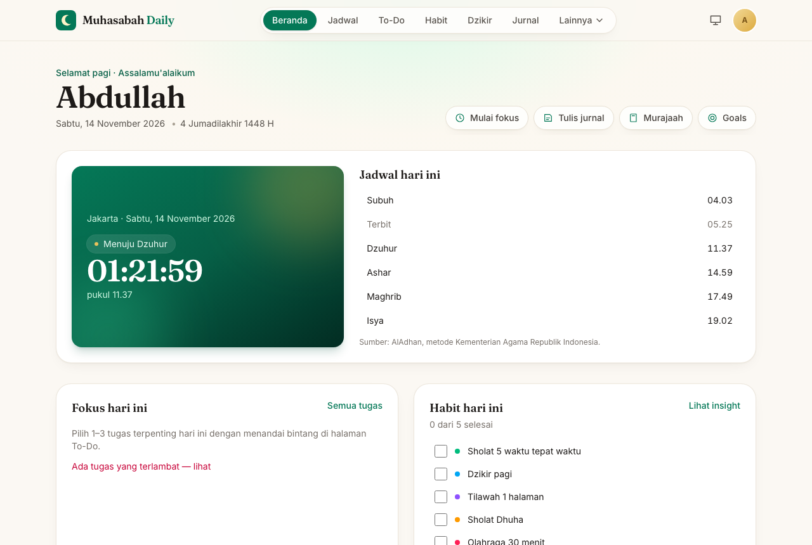
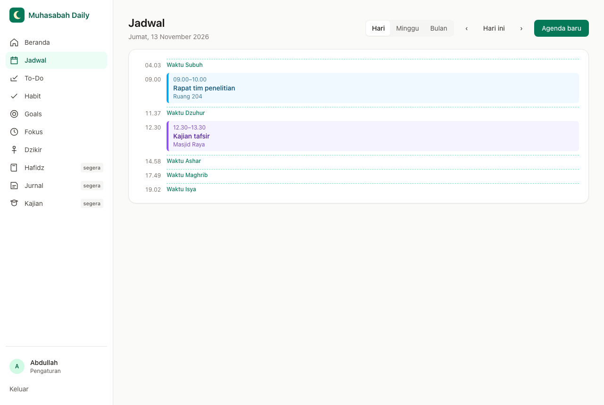
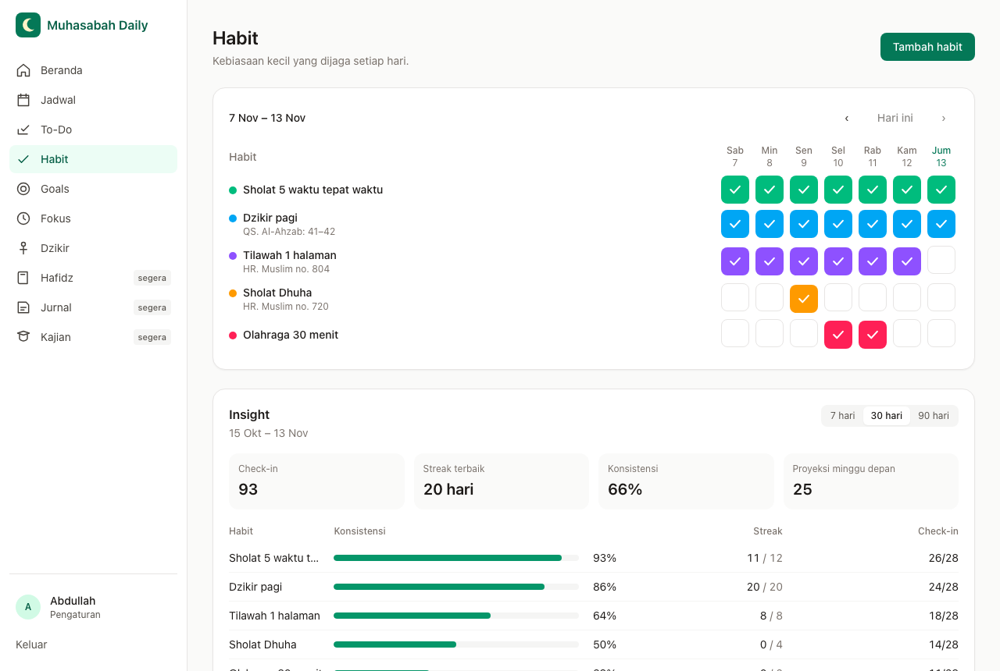
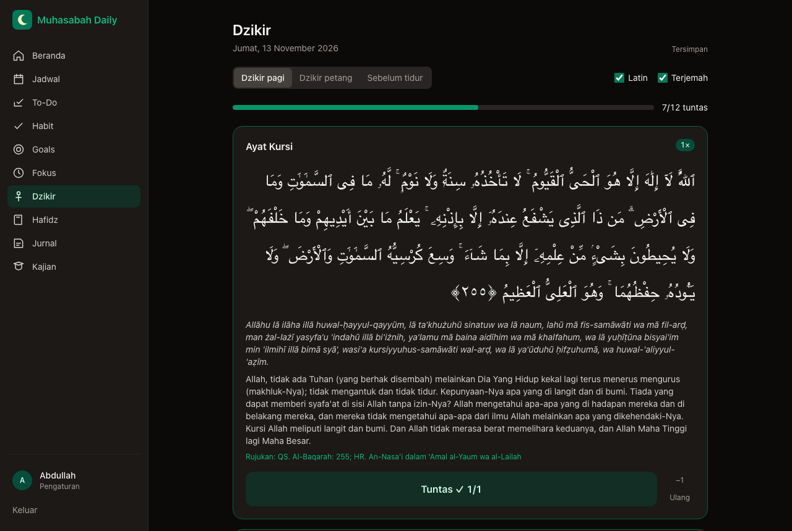
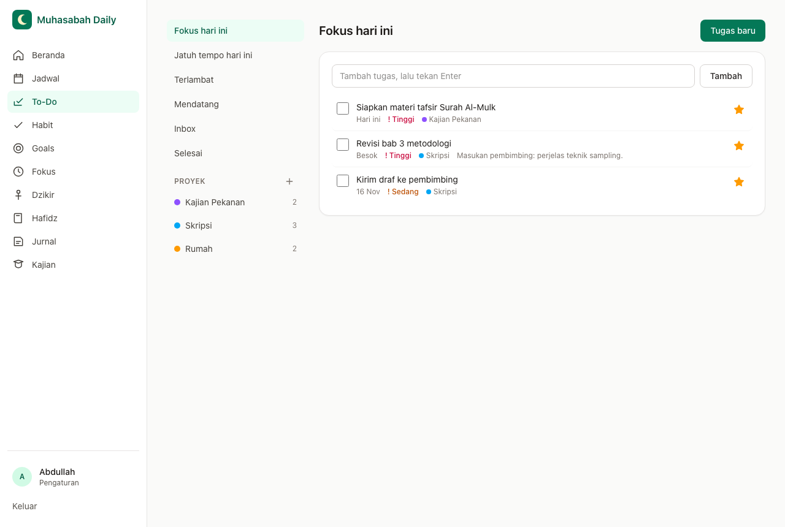
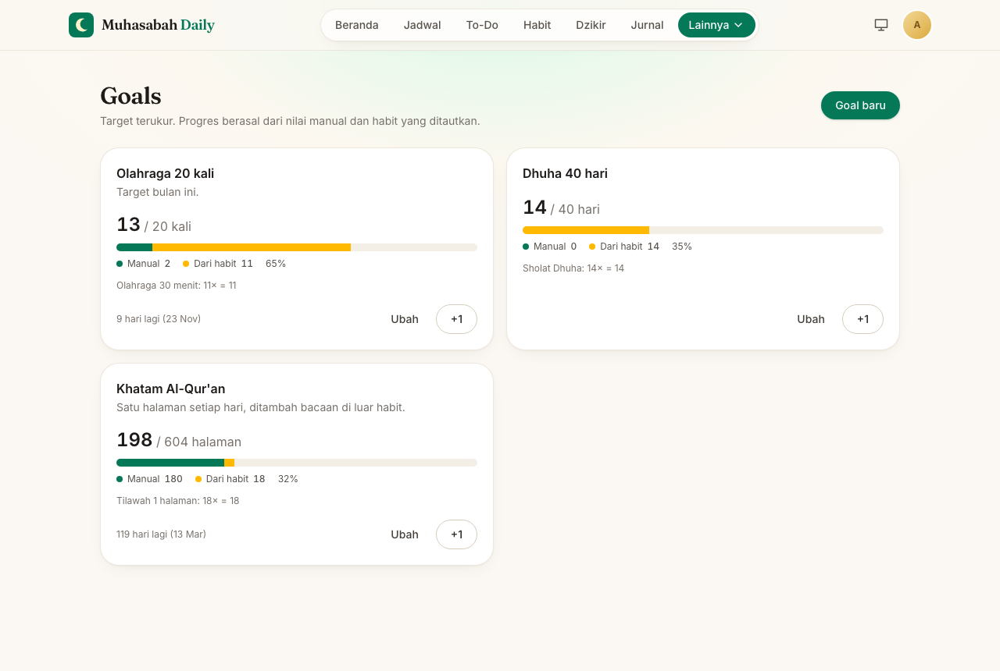
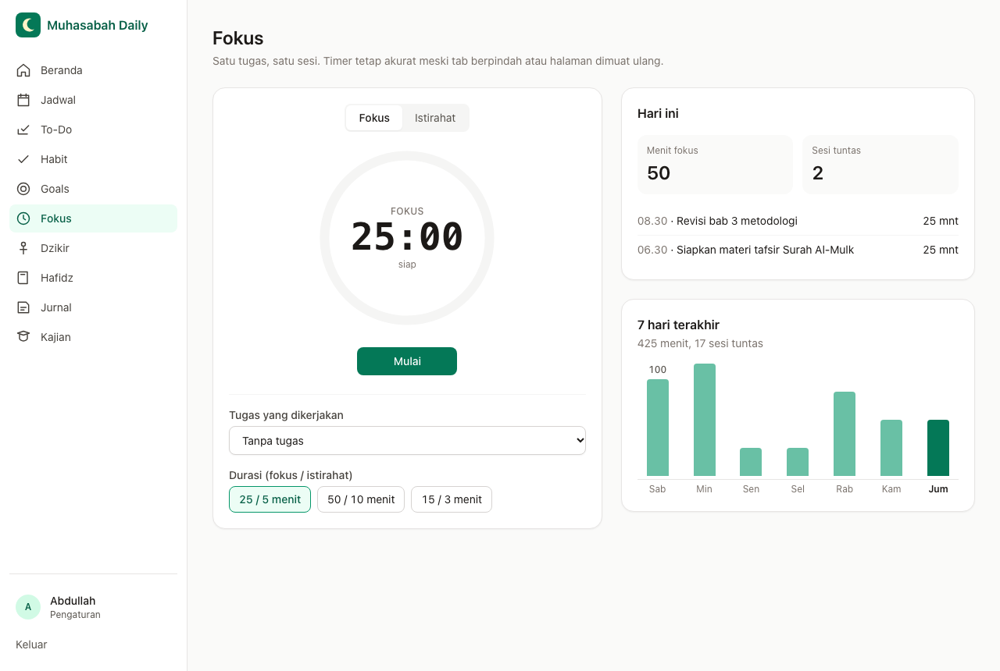

# Muhasabah Daily

Aplikasi produktivitas Muslim open source yang dijalankan di komputermu sendiri. Jadwal, to-do, habit, goals, fokus, dzikir, hafalan, jurnal, dan catatan kajian disusun di sekitar waktu sholat.

> **v1.1.0** — tampilan baru bergaya web personal: navigasi header di desktop, tab bar di ponsel, dan tombol mode gelap. Lihat [CHANGELOG.md](CHANGELOG.md).



## Fitur

- **Waktu sholat** (AlAdhan, metode Kemenag RI) dengan hitung mundur ke sholat berikutnya; tetap tampil dari cache saat sumber tidak bisa dihubungi.
- **Jadwal** hari/minggu/bulan. Tampilan hari menyisipkan waktu sholat di antara agenda.
- **To-Do** dengan proyek, prioritas, tenggat, dan _fokus hari ini_ yang kedaluwarsa sendiri saat hari berganti.
- **Habit** dari library 46 template (habit ibadah menyertakan rujukan), grid mingguan, dan insight: streak, konsistensi, proyeksi minggu depan.
- **Goals** terukur yang progresnya berasal dari nilai manual dan centang habit tertaut.
- **Fokus**: timer 25/5, 50/10, 15/3 yang tetap akurat saat tab berpindah atau halaman dimuat ulang, dengan pengingat bila waktu sholat masuk di tengah sesi.
- **Dzikir** pagi, petang, dan sebelum tidur dengan teks Arab, latin, terjemah, rujukan, dan penghitung yang tetap berjalan saat offline.
- **Hafidz**: rencana hafalan dengan tahapan tikrar (dengar, baca sendiri, sambung) dan pemutar murottal per ayat.
- **Jurnal** harian dengan simpan otomatis dan **AI Polish** opsional (Claude, kunci API milikmu) yang merapikan ejaan tanpa menimpa teks asli.
- **Catatan Kajian** dengan editor teks kaya dan rujukan ayat yang menampilkan teks Arab dan terjemah.
- Tombol mode gelap (terang/gelap/ikuti sistem) di header, tampilan ponsel dengan tab bar bawah, dan audit aksesibilitas WCAG 2.1 AA otomatis di setiap halaman.

| Jadwal hari                                                          | Habit dan insight                                         | Dzikir (gelap)                                                 |
| -------------------------------------------------------------------- | --------------------------------------------------------- | -------------------------------------------------------------- |
|  |      |    |
| **To-Do**                                                            | **Goals**                                                 | **Fokus**                                                      |
|                    |  |  |

## Stack

Vue 3 + Vite + Pinia + Tailwind · NestJS 11 + Prisma 7 · PostgreSQL 17 · Redis 7 · TypeScript di seluruh stack, skema validasi bersama dengan Zod. Detail di [ARCHITECTURE.md](ARCHITECTURE.md).

## Menjalankan

Cukup Docker (Compose v2.24+):

```bash
git clone <url-repositori> muhasabah-daily && cd muhasabah-daily
docker compose up -d
```

Buka **http://localhost:8080**. Migrasi, data dasar, dan data Al-Qur'an disiapkan otomatis saat start pertama; secret dibuat sendiri bila `.env` tidak ada. Bisa dipasang sebagai aplikasi (PWA) dari browser. Konfigurasi, akses dari ponsel, HTTPS, pencadangan, dan pembaruan dijelaskan di **[docs/self-hosting.md](docs/self-hosting.md)**.

## Pengembangan

Butuh Node 22+ (disarankan 24), pnpm 11, dan Docker.

```bash
cp .env.example .env
# isi JWT_ACCESS_SECRET dan JWT_REFRESH_SECRET, mis. dengan: openssl rand -hex 32

docker compose up -d db redis
pnpm install
pnpm --filter api db:deploy   # migrasi basis data
pnpm --filter api seed        # library habit dan dzikir (aman diulang; tambah -- --offline tanpa internet)
pnpm --filter api seed:quran -- --direct   # data Al-Qur'an lengkap (sekali, butuh internet, ±15 detik)
pnpm dev                      # web http://localhost:5173, API http://localhost:3000
```

Dokumentasi API (Swagger): http://localhost:3000/docs

### AI Polish (opsional)

Isi di `.env` lalu jalankan ulang API:

```bash
AI_PROVIDER=anthropic
AI_API_KEY=sk-ant-...        # kunci Anthropic API milikmu
# AI_MODEL=claude-opus-5-5   # bawaan
# AI_DAILY_LIMIT=10          # batas per pengguna per hari
```

Teks jurnal hanya dikirim ke penyedia AI saat pengguna menekan **Poles dengan AI**.

### Mencoba dengan data contoh

```bash
pnpm --filter api seed:demo   # akun demo@muhasabah.local / demo12345 dengan riwayat 4 minggu
```

Perintah ini membuat ulang akun demo setiap dijalankan dan ditolak saat `NODE_ENV=production`.

Semua di container sekaligus:

```bash
docker compose --profile full up --build
```

## Skrip

| Perintah                                     | Fungsi                                                                                   |
| -------------------------------------------- | ---------------------------------------------------------------------------------------- |
| `pnpm dev`                                   | Jalankan shared (watch), API, dan web                                                    |
| `pnpm lint` / `pnpm format`                  | ESLint / Prettier                                                                        |
| `pnpm typecheck`                             | Cek tipe semua paket                                                                     |
| `pnpm test`                                  | Test unit dan integrasi (butuh `db` dan `redis` berjalan)                                |
| `pnpm test:e2e`                              | E2E Playwright (pertama kali: `pnpm --filter web exec playwright install chromium`)      |
| `pnpm build`                                 | Build produksi API dan web                                                               |
| `pnpm --filter api seed:demo`                | Buat ulang akun demo beserta datanya                                                     |
| `pnpm --filter api seed:quran`               | Impor data Al-Qur'an lewat antrean (`-- --direct` tanpa API, `-- --fixture` data uji)    |
| `pnpm --filter web screenshots`              | Perbarui `docs/screenshots/` (butuh `pnpm dev` dan `seed:demo`; `BASE_URL` untuk Docker) |
| `pnpm --filter api db:migrate --name <nama>` | Buat migrasi baru                                                                        |

## Struktur

```
apps/api         NestJS: auth, users, prayer-times, events, tasks, habits, goals, focus, dhikr, quran, memorization, journal + ai, lecture-notes, health
apps/web         Vue 3 SPA
packages/shared  Tipe, kode error, dan skema zod yang dipakai web dan api
```

## Data pihak ketiga

Waktu sholat diambil dari [AlAdhan](https://aladhan.com) (metode Kemenag RI). Teks Al-Qur'an, terjemah, dan audio tidak disimpan di repo. Lihat [DATA_SOURCES.md](DATA_SOURCES.md).

## Kontribusi

Lihat [CONTRIBUTING.md](CONTRIBUTING.md).

## Lisensi

[MIT](LICENSE)
